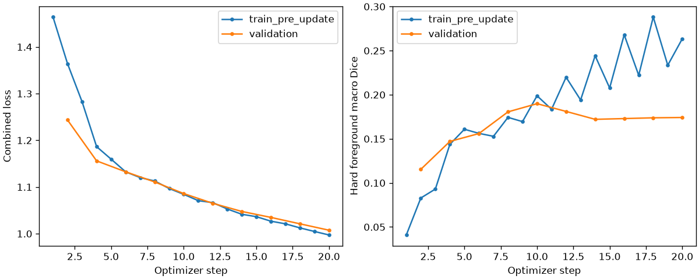
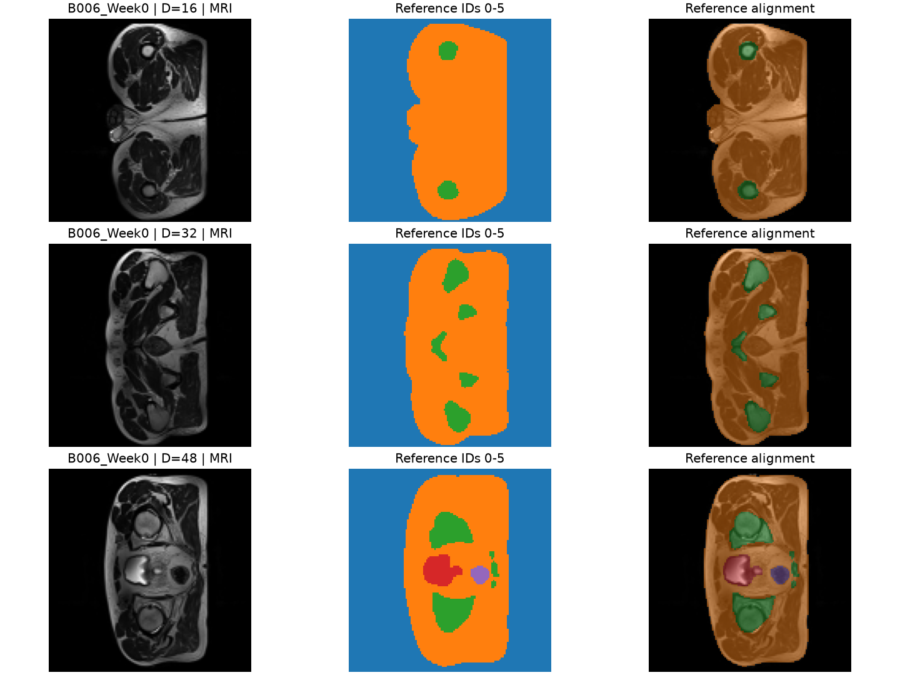
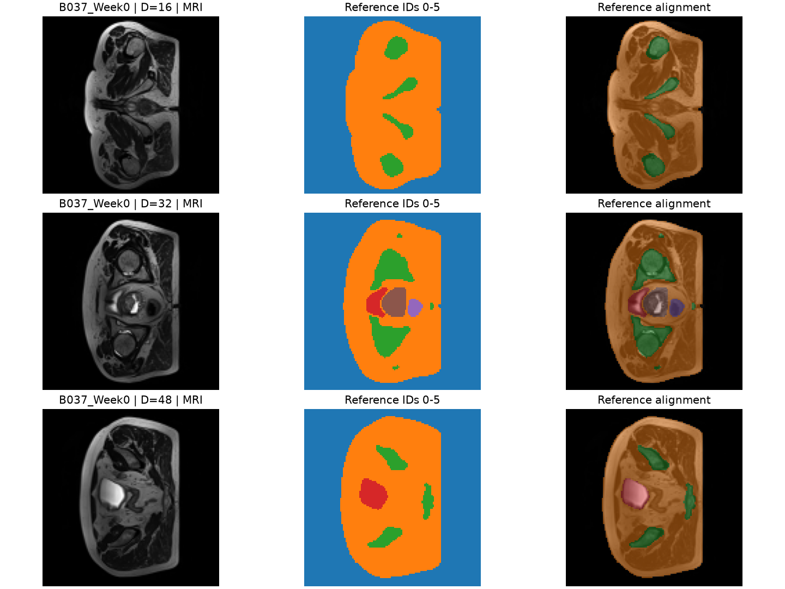
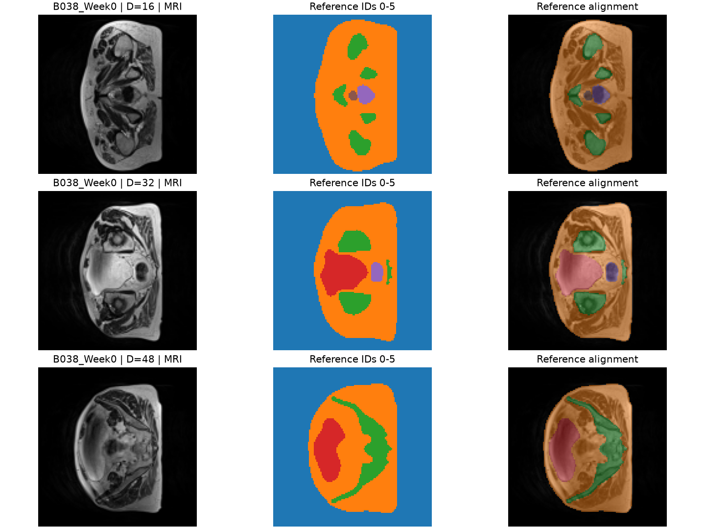

# Feasibility review: HipMRI Improved 3D U-Net

## 1. Aim and success criteria

Build an Improved 3D U-Net to help an imaging specialist review contours for prostate radiotherapy planning. Compare it with a standard 3D U-Net to see whether better boundaries justify the extra computing cost.

Success means:

- **Reliable data:** check image-mask alignment and label meanings, and keep patients separate across training, validation and test sets.
- **Segmentation accuracy:** aim for test Dice **>=0.70** and report Dice and IoU for each verified class. Confirm the required averaging rule with the tutor.
- **Better boundaries:** compare prostate precision, recall and boundary distance (HD95), and show **3-5 failure cases** with predictions and error overlays.
- **Practical cost:** measure GPU memory and full-case prediction time for both models. The proposed memory budget is **14 GB on a 16 GB GPU**.

These are goals, not achieved results. This project compares two 3D models; it does not test whether 3D is better than 2D.

## 2. Model and approach

**Chosen difficulty: Hard ? Improved 3D U-Net.**

Start with a small standard 3D U-Net, then add two ideas from Isensee et al. [2]: residual blocks, which add a block's input to its learned output, and combined predictions from several decoder levels. This is a smaller adaptation of the paper's model.

Both models will use the same patient splits, input size and training settings, with an equal mix of Dice loss and cross-entropy. Select checkpoints using validation foreground Dice, then compare accuracy, boundary errors, memory and speed on the same test cases.

## 3. Prototype and initial results

The baseline uses **B006 and B037 for training** and **B038 for validation**, with six label IDs and an input size of `(64, 128, 128)`. The first run completed **10 epochs (20 updates) on CPU**. Code and run instructions are in [`mvp3d/README.md`](mvp3d/README.md).

*Figure 1. Loss decreases, but validation Dice peaks at epoch 5.*

Training loss fell from **1.464 to 0.997**. Validation foreground Dice peaked at **0.190**, then ended at **0.174**. The model mainly learned background and class 1; classes 2-5 still performed poorly. Training works, but accurate segmentation has not yet been demonstrated.

The images below show **MRI, supplied reference masks and alignment overlays**, not model predictions.

*Figure 2. B006, the first training case. The reference broadly matches the visible structures.*

*Figure 3. B037, the second training case, used to check alignment after resizing.*

*Figure 4. B038, the validation case. Prediction images are still needed to inspect model errors.*

All six labels survived resizing, but small structures need closer review. Patient identities and anatomical label meanings also remain unverified.

**Next:** inspect predictions from the best checkpoint, then train longer on B006 alone to check whether every class can be learned. GPU memory, full-case prediction time and separate test-set performance are still unmeasured. This small run does not demonstrate the assignment's Dice target.

## 4. Main risks

- **Wrong labels or alignment:** inspect masks and verify class meanings.
- **Patient overlap or overfitting:** keep repeat scans together and evaluate on unseen patients.
- **Missing small structures:** check each class, since falling loss can hide poor segmentation.
- **Unfair comparison:** use matching settings and keep the test set untouched until final evaluation.
