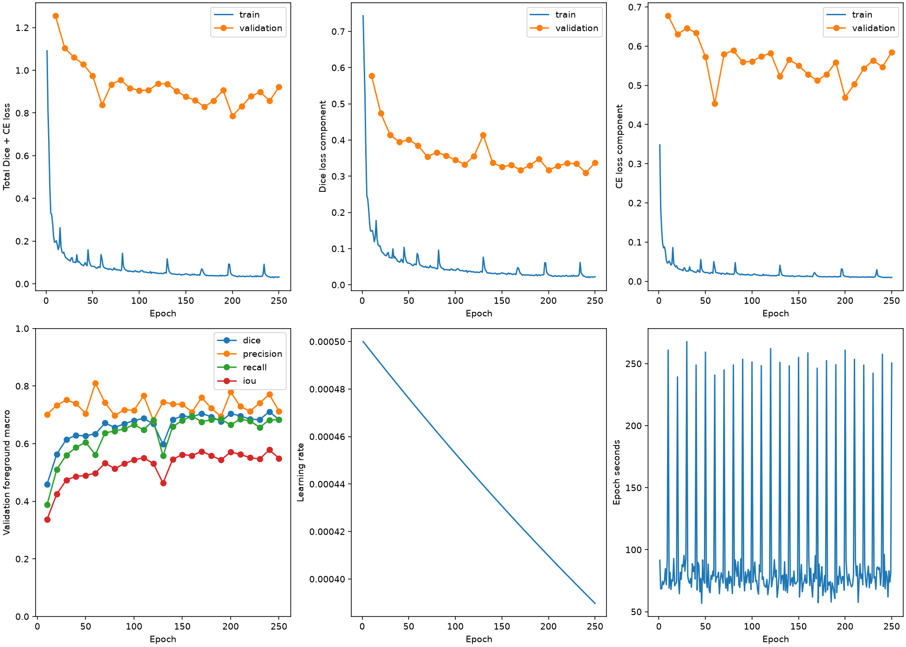
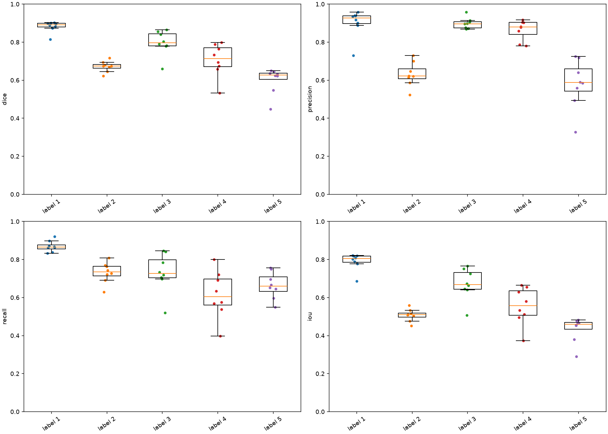
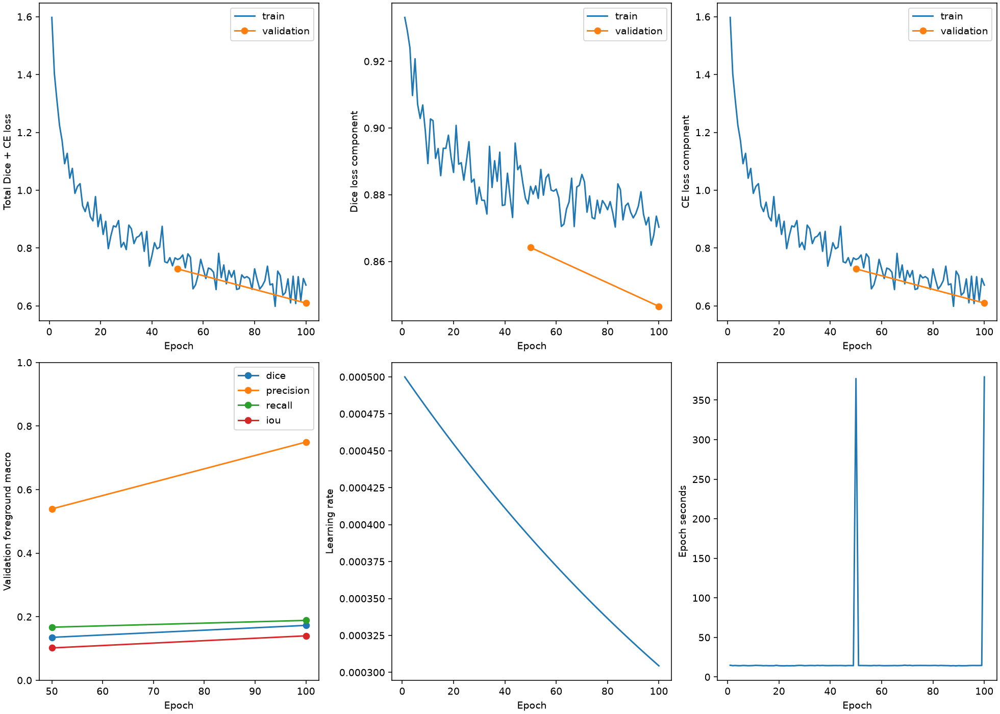
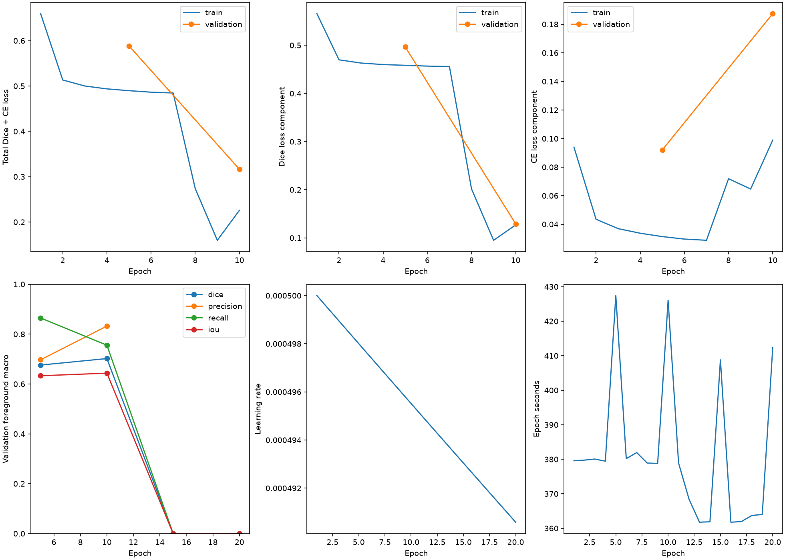
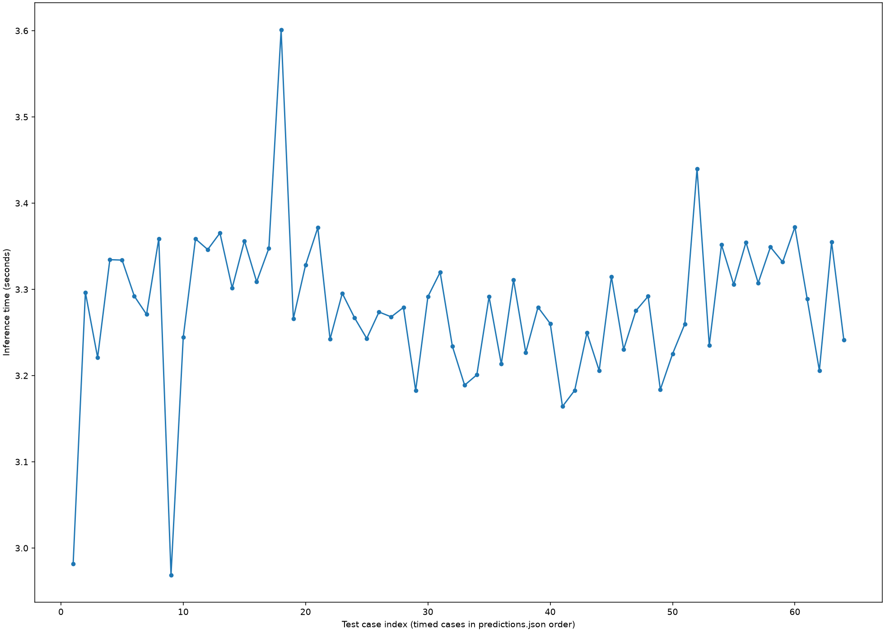
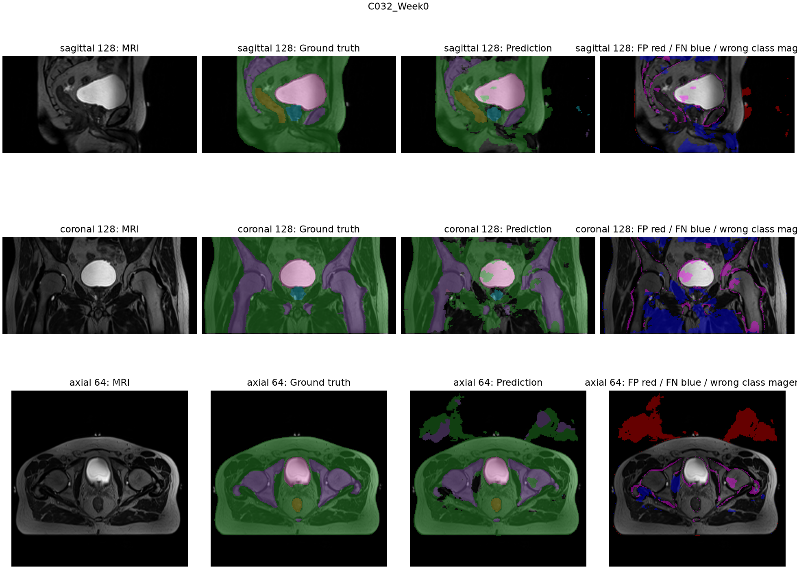
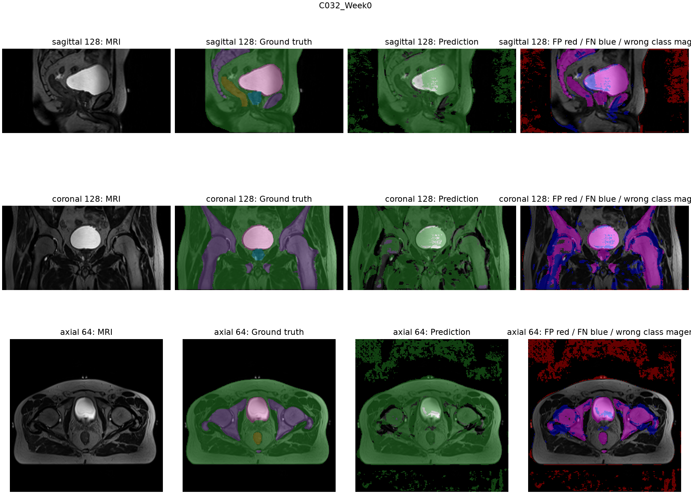
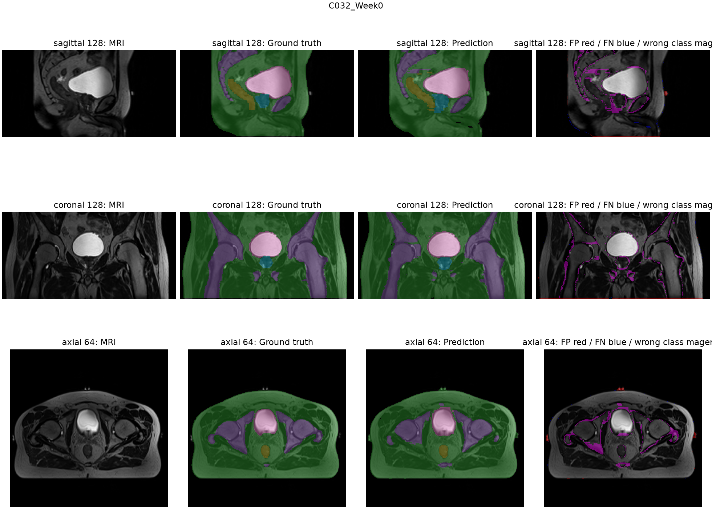

# Segmentation: Improved 3D UNet vs. Normal 3D UNet vs. 2D UNet (s4762451)

**Name: Gia Hao Vo**

**ID: 47624513**

**COMP3710: Project 2.2: Hard Difficulty**

---

> **Research focus:** This project mainly investigate the application of an Improved 3D UNet into Segmentation of MRI Data. Using the dataset provided, we design a pipeline to preprocess, load data, train, predict, evaluate and test the model. Then, we also compare with another 2D UNet model to see if the computational cost of Improved 3D UNet actually worths it.

> **Goal**: Achieve Dice score >= 0.7 for Improved 3D UNet

> **Additional research**: For furthur research interest, our project also includes: 1 2D UNet model, and 1 (Normal) 3D UNet model. We will use the same dataset, with relatively comparable configuration for each models. These additional models, despite not being the main focus,are expected to deliver more comparison insights to analyse/benchmark how good our main model is (and hopefully any other insights).
---

## Contents

- [1. Project overview](#1-project-overview)
- [2. Installation and usage](#2-installation-and-usage)
- [3. Methodology](#3-methodology)
- [4. Results and analysis](#4-results-and-analysis)
- [5. Have we answered the research questions?](#5-have-we-answered-the-research-questions)
- [6. Feasibility review](#6-feasibility-review)
- [7. Artificial Intelligence Usage Disclosure](#7-artificial-intelligence-usage-disclosure)
- [8. References](#8-references)

## 1. Project overview

This project investigates whether an Improved 3D UNet model of choice can perform good segmentation of MRI prostate segmentation. We use Dice score, alongside with other metrics, to evaluate and analyse how well this model performs. A high average Dice score can hide local errors. This project asks both how well a model segments the anatomy and where its predictions remain unreliable. Hence, it also compares a 2D U-Net and a normal 3D U-Net to examine whether additional spatial context produces more reliable anatomical contours.

**Dataset:** HipMRI contains labelled, provided by COMP3710 course. The local dataset used here contains 211 paired NIfTI scans from 38 patient IDs, with background and five foreground label IDs.

**Scope for Dataset:** *This project only use one 3D MRI dataset despite viewing both 2D and 3D data* . Despite having another 2D dataset, our justification is that we want to give all models an equal comparison ground. The 2D dataset, after investigation, have slightly different structures, datatype, and data splitting structures. Hence, we created separate preloader to preprocessed the 3D dataset into the expected 3D data, and a collection of different 2D slices for the 2D model. This creates additional workload for the project. However, we believe this is the interesting way to examine the question.

### 1.1 Research questions

**RQ1: Model:** Does incorporating true 3D volumetric continuity (3D Improved U-Net) genuinely eliminate these hazardous boundary and slice-transition errors compared to a standard 2D baseline (2D U-Net)? Or does it merely smooth easy central slices while demanding 5–10× the GPU memory and training time?


**RQ2: Engineering value:** Pinpoint anatomically where spatial context delivers measurable clinical gain and where it breaks down. Deliver an evidence-based recommendation on whether 3D volumetric context justifies the computational budget in an operational contouring pipeline.

### 1.2 Comparison strategy

| Comparison | What it investigates | What the discussion must establish |
| :--- | :--- | :--- |
| Normal 3D U-Net vs 2D U-Net | Practical benefit of volumetric context | Whether cross-slice continuity and difficult regions improve, alongside changes in overlap and cost |
| Improved 3D U-Net vs Normal 3D U-Net | Benefit of the improved architecture | Which verified architectural changes accompany improvements, regressions or additional cost |
| Improved 3D U-Net vs 2D U-Net | Overall benefit of the proposed pipeline over the slice-wise baseline | Whether the strongest observed gains justify the total resource increase |

## 2. Installation and usage

### 2.1 Repository structure

| Location | Purpose |
| :--- | :--- |
| data/semantic_MRs/, data/semantic_labels_only/ | Original MRI volumes and reference masks |
| data/preprocess2d/, data/preprocess3d/ | Cached slices or volumes and geometry metadata |
| preloader.py | Prepare both caches before running a pipeline |
| main3d.py, train.py, dataset.py, modules.py, predict.py | Improved 3D entry point, training, loading, architecture and inference |
| main3dnormal.py, main2d.py, helpers/ | Comparator pipelines, preprocessing, models and shared evaluation |
| configs/ | Model, training, preprocessing, label and patient split settings |
| graphs/ | Plotting from saved logs and metrics |
| outputs/ | Checkpoints, logs, predictions, metrics and figures |
| readme_outputs/ | Copies of PNG figures and summary JSON logs, retaining the outputs/ subfolders |
| readme/ | Prototype figures and project reference PDFs |
| tests/test_pipeline.py | Pipeline checks |
| requirements.txt | Project dependencies |

### 2.2 Environment and dependencies

The saved runtime records Python 3.12.15, PyTorch 2.14.1+cu130, CUDA 13.0 and an NVIDIA GeForce RTX 4070 Ti SUPER. The 3D runs also record TorchMetrics 1.6.1, NumPy 2.5.4, SciPy 1.18.1, NiBabel 5.4.2, scikit-learn 1.8.0 and Matplotlib 3.11.2. These are recorded run versions, rather than a newly tested installation. See each original outputs/<run>/runtime.json and [requirements.txt](requirements.txt).

From this project directory:

```powershell
py -3.12 -m venv .venv
.\.venv\Scripts\python.exe -m pip install -r requirements.txt
```

The requirements pin a CUDA-specific PyTorch build. The pipeline falls back to CPU when CUDA is unavailable; the reported timings use the GPU.

### 2.3 Running the pipeline

Place matching *_LFOV.nii.gz images in data/semantic_MRs/ and *_SEMANTIC.nii.gz masks in data/semantic_labels_only/. Review the patient manifest and corresponding training JSON before execution. Run the preloader before each main pipeline:

```powershell
# Preprocess all data files to avoid heavy pipeline
.\.venv\Scripts\python.exe preloader.py

# Improved 3D U-Net
.\.venv\Scripts\python.exe main3d.py

# Normal 3D U-Net
.\.venv\Scripts\python.exe main3dnormal.py

# 2D U-Net
.\.venv\Scripts\python.exe main2d.py
```

## 3. Methodology

### 3.1 Algorithm and workflow

The pipeline pairs images with masks, groups repeat visits by patient and builds separate 2D and 3D caches. It trains each model, selects the checkpoint with the highest validation foreground Dice, reconstructs predictions in the original scan geometry and evaluates held-out patients. Patient separation prevents repeat visits from crossing partitions, while original-grid evaluation includes reconstruction errors. The stage order is implemented in [helpers/pipeline.py](helpers/pipeline.py).

### 3.2 Model architectures

| Property | Improved 3D U-Net | Normal 3D U-Net | 2D U-Net |
| :--- | :--- | :--- | :--- |
| Input representation | Cropped volumes in training; windows at inference | 3D patches | Source-axis-2 slices |
| Architecture reference | [Isensee et al., 2018](https://arxiv.org/abs/1802.10508), smaller adaptation | [Çiçek et al., 2016](https://arxiv.org/abs/1606.06650), adapted training | [Ronneberger et al., 2015](https://arxiv.org/abs/1505.04597), six-class output |
| Model file / configuration | [modules.py](modules.py) / [training3d.json](configs/training3d.json) | [model3dnormal.py](helpers/model3dnormal.py) / [training3dnormal.json](configs/training3dnormal.json) | [model2d.py](helpers/model2d.py) / [training2d.json](configs/training2d.json) |
| Input channels / spatial dimensions | 1 / variable crop; inference 96x96x96 | 1 / 132x132x116 input, 44x44x28 output | 1 / 572x572 input, 388x388 output |
| Encoder stages / channels per stage | 4: 16, 32, 64, 128; bottleneck 256 | 3: 64, 128, 256; bottleneck 512 | 4: 64, 128, 256, 512; bottleneck 1024 |
| Convolutions per stage / kernel / stride / padding | Residual block: two 3^3, stride 1, padding 1; decoder: 3^3 then 1^3 | Two 3^3, stride 1, padding 0; encoder middle width is half its output width | Two 3x3, stride 1, padding 0 |
| Downsampling operation | Four 3^3 convolutions, stride 2, padding 1 | Three 2^3 max-pools, stride 2 | Four 2x2 max-pools, stride 2 |
| Bottleneck configuration | 256-channel residual block | Valid convolutions: 256 then 512 channels | Two valid 1024-channel convolutions |
| Decoder stages / channels per stage | 4: 128, 64, 32, 16 | 3: 256, 128, 64 | 4: 512, 256, 128, 64 |
| Upsampling / skip-feature alignment | Nearest-neighbour resize to skip size, 3^3 convolution, concatenation | 2^3 transposed convolution, stride 2; centre-cropped skips | 2x2 transposed convolution, stride 2; centre-cropped skips |
| Normalisation / activation / dropout | Affine InstanceNorm3d; LeakyReLU 0.01; residual dropout 0.3 | Affine BatchNorm3d without running statistics; ReLU; no dropout | No normalisation; ReLU; no dropout |
| Residual units | Each encoder level and bottleneck; identity addition after two convolutions | None | None |
| Deep supervision | Heads at decoder widths 64, 32 and 16; upsample and sum logits under one final loss | None | None |
| Output head / class count | Three 1^3 heads combined into 6 logits | 1^3 convolution / 6 | 1x1 convolution / 6 |
| Trainable / total parameters | 9,465,138 / 9,465,138 | 19,073,990 / 19,073,990 | 31,030,918 / 31,030,918 |

### 3.3 Dataset, preprocessing and patient splits

All pipelines use [configs/splits.json](configs/splits.json). Its 24 training, 6 validation and 8 test patient IDs are disjoint, with all available visits kept together. The cached manifests contain the same 211 scans for both representations. Counts below describe this local dataset, not the full published collection.

Both 3D models reuse the same cache. Target spacing is the median of within-patient median spacings from training patients only. Intensity normalisation is calculated independently for each volume or slice, without fitting intensity statistics across the test set. See [preprocess3D.py](helpers/preprocess3D.py) and [preprocess2D.py](helpers/preprocess2D.py).

| Preprocessing detail | Actual implementation |
| :--- | :--- |
| Input modalities and label IDs | One LFOV MRI channel; sequence unverified. Source IDs 0-5 map directly to six classes. ID 0 is background; anatomical names for IDs 1-5 are unverified in labels.json. |
| Orientation and spacing | 3D: canonical RAS and linear image resampling to approximately (1.6797, 1.6797, 1.5600) mm. 2D: source grid and axis-2 slices; no canonical reorientation or spacing resampling. |
| Intensity normalisation | 3D: z-score nonzero voxels within each cropped volume, retaining zero background; standard-deviation floor 1e-8. 2D: z-score all pixels of each slice with denominator std + 1e-8. |
| Slice / patch dimensions and sampling | Improved 3D: whole cached crop, commonly around 255x256x128; 96^3 is its inference window. Normal 3D: random 132x132x116 patches supervising a 44x44x28 centre. 2D: all slices, reflected context padding and 572x572 tiles supervising 388x388 regions. |
| Training augmentation | No flips, rotations, elastic deformation or intensity augmentation in the current loaders. Normal 3D random patch positioning provides spatial sampling only. |
| Inference reconstruction and geometry restoration | 3D: Gaussian-weighted window logits, softmax, uncrop, then linearly resample probabilities to the original grid before argmax. 2D: stitch output tiles and return slices to their original axis and index. Both save the original affine, qform and sform. |

3D masks are resampled onto the image grid with nearest-neighbour interpolation and receive the same crop. For 2D, masks are aligned to the source image grid with nearest neighbours when necessary. The 3D crop uses image values above zero with a four-voxel margin, without consulting labels. Original shape, affine and crop geometry are retained for reconstruction.

#### Model configuration for the whole pipeline

| Setting | Improved 3D U-Net | Normal 3D U-Net | 2D U-Net |
| :--- | :--- | :--- | :--- |
| Patient split manifest | configs/splits.json | Same patient IDs | Same patient IDs |
| Modalities / class mapping | LFOV / IDs 0-5 | Same | Same |
| Orientation / voxel spacing | RAS / training-derived spacing above | Same 3D cache | Source orientation and spacing |
| Normalisation / cropping | Nonzero per-volume z-score / image foreground crop | Same 3D cache | Per-slice z-score / no foreground crop |
| Training unit and sampling | Whole crop; patients have equal total sampling weight across visits | Random patch; same patient weighting | Every source-axis-2 slice; shuffled tiles without patient weighting |
| Augmentation | None | Random patch location only | None |
| Inference reconstruction | 96^3 windows, 50% overlap, batch 2, Gaussian blending | 44x44x28 output windows, 25% overlap, batch 4, Gaussian blending | Reflected context, non-overlapping output tiles, original slice ordering |
| Geometry restoration | Uncrop and resample probabilities | Same | Direct source-grid volume assembly |

### 3.4 Training

#### Training and Prediction

These settings come from the saved outputs/<run>/resolved-config.json files and training implementations. Current pipeline flags may differ from those used to produce the runs.

| Setting | Improved 3D U-Net | Normal 3D U-Net | 2D U-Net |
| :--- | :--- | :--- | :--- |
| Loss components / weights | Dice component + cross-entropy, 1:1 | Cross-entropy only; Dice weight 0 | Soft Dice + cross-entropy, 1:1 |
| Optimiser / learning rate / weight decay | Adam / 5e-4 / 1e-5 | SGD, momentum 0 / 5e-4 / 1e-5 | Adam / 5e-4 / 1e-5 |
| Learning-rate schedule | Exponential, x0.999 per epoch | Exponential, x0.995 per epoch | Exponential, x0.999 per epoch |
| Batch size | 1 | 1 | 4  |
| Precision / seed | CUDA FP16 autocast and gradient scaler / no seed set | Same | Same |
| Maximum epochs / updates per epoch | 250 / 100 batches | 100 / 100 batches | 20 / 3,616 batches covering 14,464 tiles |
| Validation frequency and coverage | Every 10 epochs; all 34 validation scans | Every 50 epochs; all 34 validation scans | Every 5 epochs; all 4,352 validation slices |
| Stopping rule / checkpoint selection | Five consecutive validations above 0.70 or epoch limit; highest validation Dice | Same rule | Same rule |
| Hardware / compute budget | RTX 4070 Ti SUPER / 6.519 h recorded | Same GPU / 0.603 h recorded | Same GPU / 2.121 h recorded |
| Actual epochs / updates completed | 250 epochs / 25,000 batches; best epoch 240 | 100 epochs / 10,000 batches; best epoch 100 | 20 epochs / 72,320 batches processed; best epoch 10; non-finite losses from epoch 11 |

All loops follow the same train, validate and checkpoint workflow, but their optimisation settings differ. The 2D loop covers all slice tiles each epoch; the 3D loops draw 100 patient-balanced samples. The improved loader returns full cropped volumes despite its PatchDataset name. Normal 3D supervises only the valid central patch, and both valid-convolution comparators ignore padded targets with label -100. See [train.py](train.py), [train3dnormal.py](helpers/train3dnormal.py) and [train2d.py](helpers/train2d.py).

### 3.5 Evaluation protocol


| Metric | Purpose |
| :--- | :--- |
| Dice / F1 | Primary foreground overlap measure; report once because these are equivalent here |
| IoU / Jaccard | Complementary overlap measure |
| Precision | Identify excess foreground predictions |
| Recall / sensitivity | Identify missed foreground |
| Total loss, Dice loss component and cross-entropy | Track optimisation and validation; normal 3D logs Dice loss but gives it zero training weight |
| Per-class and patient mean / standard deviation | Show variation hidden by the foreground mean |
| Valid / excluded counts | Identify undefined scores omitted from averages |
| Dice target status | Check whether all classes have evaluable Dice and macro Dice exceeds 0.70 in the 3D summaries |
| Parameter count | Describe model size |
| Epoch seconds / summed training time | Measure the training loop, including scheduled validation |
| Test inference seconds | Measure cached-data loading through reconstructed prediction, excluding NIfTI writing |
| Peak GPU allocated MiB | Maximum PyTorch-allocated GPU memory during each test scan |
| Learning rate / selected epoch | Record optimisation schedule and checkpoint choice |

### 3.6 Testing

Testing loads the validation-selected best.pt, predicts all 64 scans from the eight held-out patients and evaluates the reconstructed masks. Selected epochs are 240 for Improved 3D, 100 for Normal 3D and 10 for 2D. Section 4 uses test outputs for segmentation quality, inference memory and latency; training logs are used only for convergence and training cost. The code keeps test patients out of training, although the outputs alone cannot verify that earlier manual tuning never consulted the test set.

## 4. Results and analysis

### 4.1 Segmentation quality

The main inference on the held out test set for each model:

All tables use the same eight test patients and 64 scans. The 2D table retains its recorded slice-based aggregation; the 3D tables use full-scan aggregation as explained in Section 3.5. Label IDs follow configs/labels.json; anatomical names are not inferred from appearance.

**Improved 3D U-Net** ([test summary](readme_outputs/improved_3d_unet/test/evaluation-summary.json))

| Segmentation class | Dice | IoU | Precision | Recall |
| :--- | ---: | ---: | ---: | ---: |
| Label 1 | 0.8820 | 0.7901 | 0.9010 | 0.8691 |
| Label 2 | 0.6718 | 0.5071 | 0.6304 | 0.7315 |
| Label 3 | 0.7968 | 0.6714 | 0.8984 | 0.7309 |
| Label 4 | 0.7050 | 0.5551 | 0.8640 | 0.6152 |
| Label 5 | 0.6002 | 0.4334 | 0.5799 | 0.6637 |
| Foreground macro | 0.7312 | 0.5914 | 0.7747 | 0.7221 |

**Normal 3D U-Net** ([test summary](readme_outputs/normal_3d_unet/test/evaluation-summary.json))

| Segmentation class | Dice | IoU | Precision | Recall |
| :--- | ---: | ---: | ---: | ---: |
| Label 1 | 0.7959 | 0.6636 | 0.7126 | 0.9097 |
| Label 2 | 0.0536 | 0.0276 | 0.4623 | 0.0286 |
| Label 3 | 0.0005 | 0.0002 | 0.7917 | 0.0002 |
| Label 4 | 0.0000 | 0.0000 | N/A | 0.0000 |
| Label 5 | 0.0000 | 0.0000 | N/A | 0.0000 |
| Foreground macro | 0.1700 | 0.1383 | 0.6555 | 0.1877 |

**2D U-Net** ([test summary](readme_outputs/2d_unet/test/evaluation-summary.json))

| Segmentation class | Dice | IoU | Precision | Recall |
| :--- | ---: | ---: | ---: | ---: |
| Label 1 | 0.9753 | 0.9592 | 0.9741 | 0.9843 |
| Label 2 | 0.8798 | 0.7932 | 0.8960 | 0.8758 |
| Label 3 | 0.7055 | 0.6632 | 0.8990 | 0.7326 |
| Label 4 | 0.6120 | 0.5403 | 0.7470 | 0.7041 |
| Label 5 | 0.5880 | 0.4943 | 0.5988 | 0.7919 |
| Foreground macro | 0.7521 | 0.6900 | 0.8230 | 0.8177 |

Normal 3D's macro precision of 0.6555 is misleading without recall: classes 4 and 5 have no predicted voxels and undefined precision. Their zero Dice and recall show that this run fails to recover them. Improved 3D recovers all five classes, but label 4 precision of 0.8640 with recall of 0.6152 still indicates substantial omissions. Label 5 precision of 0.5799 identifies excess predictions as another priority. Passing the macro target does not mean every class passes: Improved 3D labels 2 and 5 remain below 0.70 Dice.

This is the main result for the Improved 3D UNet Model



The widening training-validation loss gap shows that fitting training scans is easier than generalising to unseen patients. Validation Dice peaks at 0.7110 at epoch 240 and falls to 0.6837 at epoch 250, supporting validation-based selection instead of using final weights. The best score is retained in the [best summary](readme_outputs/improved_3d_unet/best-summary.json).



Label-4 Dice varies more across patients, with standard deviation 0.0814 versus 0.0274 for label 1. This makes label 4 a greater review priority even though its mean just exceeds the target. G021's patient macro Dice is 0.6774, showing that the overall 0.7312 does not guarantee the target for every patient ([test summary](readme_outputs/improved_3d_unet/test/evaluation-summary.json)).



Normal 3D's falling cross-entropy does not translate into broad class coverage: its best validation Dice is only 0.1727. The plotted Dice component is diagnostic because its loss weight is zero. With only two validation points and a different optimiser, the result demonstrates a weak run rather than an inherent failure of volumetric context ([best summary](readme_outputs/normal_3d_unet/best-summary.json)).



The missing 2D loss values after epoch 10 and zero validation Dice at epochs 15 and 20 indicate numerical failure, not convergence. The original outputs/2d_unet/epochs.csv records non-finite training losses from epoch 11. Its [epoch-10 best summary](readme_outputs/2d_unet/best-summary.json) records validation Dice 0.7020; all reported 2D test results use that checkpoint. Test Dice of 0.7521 cannot establish superiority over 3D because its averaging unit differs.

### 4.2 Computational cost

Record performance using the best trained model version on the held out test set:

| Model | Parameters | Peak inference GPU VRAM | Inference time / patient | Total training time |
| :--- | ---: | ---: | ---: | ---: |
| 2D U-Net | 31,030,918 | 325.75 MiB | 10.34 s / 8 visits | 2.121 h |
| Normal 3D U-Net | 19,073,990 | 3,201.84 MiB | 71.53 s / 8 visits | 0.603 h |
| Improved 3D U-Net | 9,465,138 | 821.13 MiB | 26.23 s / 8 visits | 6.519 h |

> **GPU Hardware specs**: GeForce RTX 4070 Ti Super





### 4.3 Qualitative Example Figures

The same held-out scan, C032_Week0, is shown for all models. Columns show MRI, reference, prediction and errors; red marks false foreground, blue missed foreground and magenta foreground assigned to the wrong class. Each figure shows the same central sagittal, coronal and axial planes.

**Improved 3D U-Net**



**Normal 3D U-Net**



**2D U-Net**



### 4.4 Qualitative failure cases

The saved test overlays cover three matched scans, C032_Week0 to C032_Week2, for every model. These are repeat visits from one held-out patient, not three independent patients or a representative sample of the full test population. They permit a controlled visual comparison but cannot establish population-wide boundary reliability.

| Case / region | Ground-truth feature | 2D U-Net behaviour | Normal 3D U-Net behaviour | Improved 3D U-Net behaviour | Evidence and implication |
| :--- | :--- | :--- | :--- | :--- | :--- |
| C032_Week0: exterior and central axial plane | No labelled foreground in the air above the body; distinct internal classes | Mostly preserves the exterior boundary; internal class-boundary mismatches remain | Diffuse exterior false positives and extensive replacement of internal classes by the dominant green class | Recovers internal classes but adds disconnected foreground above the body and misses inferior regions | Matched [2D](readme_outputs/2d_unet/test_figures/C032_Week0-overlay.png), [Normal 3D](readme_outputs/normal_3d_unet/test_figures/C032_Week0-overlay.png), [Improved 3D](readme_outputs/improved_3d_unet/test_figures/C032_Week0-overlay.png). Volumetric context does not prevent implausible exterior predictions. |
| C032_Week1: central sagittal plane | Continuous yellow-labelled region behind the pink-labelled structure | Preserves most of the yellow region, with class-boundary errors | Largely loses the yellow and other internal regions | Yellow region contains large holes; blue error regions expose missing foreground | Matched [2D](readme_outputs/2d_unet/test_figures/C032_Week1-overlay.png), [Normal 3D](readme_outputs/normal_3d_unet/test_figures/C032_Week1-overlay.png), [Improved 3D](readme_outputs/improved_3d_unet/test_figures/C032_Week1-overlay.png). Improved 3D label-4 whole-scan Dice falls to 0.4922, compared with 0.8467 at Week0. |
| C032_Week2: inferior sagittal and coronal regions | Foreground extends through the lower part of the reference mask | Mostly retains coverage, with local class substitutions | Broad class confusion and lower-region omissions persist | Central classes are recovered, but broad inferior omissions and exterior islands remain | Matched [2D](readme_outputs/2d_unet/test_figures/C032_Week2-overlay.png), [Normal 3D](readme_outputs/normal_3d_unet/test_figures/C032_Week2-overlay.png), [Improved 3D](readme_outputs/improved_3d_unet/test_figures/C032_Week2-overlay.png). Improved 3D label-4 Dice recovers to 0.8517, while visible errors remain elsewhere. |


### 4.5 Model review

**Improved 3D U-Net:** The target is met on held-out scans, and all classes are recovered more effectively than by Normal 3D under the same scoring rule. However, label-4 omissions, label-5 excess predictions and the validation loss gap limit claims of reliability. It is the preferred volumetric candidate, with no demonstrated boundary advantage over 2D.

**Normal 3D U-Net:** Label-1 Dice of 0.7959 hides near-total failure on labels 3-5. Low training cost is not useful when class coverage is inadequate, and its inference cost is the highest. Its loss, optimiser and sampling setup need reassessment before this run can serve as a competitive baseline.

**2D U-Net:** The retained checkpoint offers the lowest measured latency and inference memory, with credible contours in the inspected scans. Its slice-averaged test Dice of 0.7521 is encouraging within that protocol, but cannot be ranked against the 3D score. Numerical failure after epoch 10 makes stable retraining a separate unresolved issue.

## 5. Have we answered the research questions?

> **Goal: Target Dice score >= 0.7: successfully achieved for Improved 3D U-Net, with best validation Dice 0.7110 and held-out test Dice 0.7312.**

### 5.1: Model

Improved 3D is the stronger volumetric pipeline: its test Dice is 0.7312 versus 0.1700 for Normal 3D, and it recovers classes the normal model almost entirely misses. This does not establish that 3D is better than 2D. The 2D checkpoint is faster and often has cleaner contours in the matched examples, while its different averaging rule prevents a direct score ranking. The improved model's exterior false positives and missing regions also refute any claim that volumetric continuity eliminates boundary errors. Its advantage over Normal 3D supports selecting this implemented pipeline, but unequal losses, optimisation and training budgets prevent attributing that advantage solely to residual blocks or deep supervision.

### 5.2: Engineering values

For continued volumetric development, prefer Improved 3D: it meets the macro target, restores all foreground classes and requires 821.13 MiB peak allocated inference memory and 3.279 seconds per scan, both lower than Normal 3D. It is most suitable when a 3D pipeline is required and its 6.519-hour training cost is acceptable. For latency or inference-memory constraints, retain the 2D epoch-10 checkpoint as the practical comparator at 1.293 seconds and 325.75 MiB per scan, while addressing its training instability. Normal 3D is currently useful as a baseline for optimisation experiments rather than the preferred segmentation model. A general recommendation to pay the 3D cost requires common full-volume scoring and broader boundary review; these results do not establish clinical gain or compliance with the proposed training-memory budget.

## 6. Feasibility review

> This feasibility review was drafted before starting the project and only contain initial ideas from early prototype. I presented this in our checkoff day.

## 6.1 Aim and success criteria

Build an Improved 3D U-Net to help an imaging specialist review contours for prostate radiotherapy planning. Compare it with a standard 3D U-Net to see whether better boundaries justify the extra computing cost.

Success means:

- **Reliable data:** check image-mask alignment and label meanings, and keep patients separate across training, validation and test sets.
- **Segmentation accuracy:** aim for test Dice **>=0.70** and report Dice and IoU for each verified class. Confirm the required averaging rule with the tutor.
- **Practical cost:** measure GPU memory and full-case prediction time for both models. The proposed memory budget is **14 GB on a 16 GB GPU (my local GPU)**.


## 6.2 Model and approach

**Chosen difficulty: Hard ? Improved 3D U-Net.**

Start with a small standard 3D U-Net, then add two ideas from Isensee et al. [2]: residual blocks, which add a block's input to its learned output, and combined predictions from several decoder levels. This is a smaller adaptation of the paper's model.

Both models will use the same patient splits, input size and training settings, with an equal mix of Dice loss and cross-entropy. Select checkpoints using validation foreground Dice, then compare accuracy, boundary errors, memory and speed on the same test cases.

## 6.3 Prototype and initial results

The baseline uses **B006 and B037 for training** and **B038 for validation**, with six label IDs and an input size of (64, 128, 128). The first run completed **10 epochs (20 updates) on CPU**.

<p align="center"></p>

*Figure 1. Loss decreases, but validation Dice peaks at epoch 5.*

Training loss fell from **1.464 to 0.997**. Validation foreground Dice peaked at **0.190**, then ended at **0.174**. The model mainly learned background and class 1; classes 2-5 still performed poorly. Training works, but accurate segmentation has not yet been demonstrated.

The images below show **MRI, supplied reference masks and alignment overlays**, not model predictions.

<p align="center"></p>

*Figure 2. B006, the first training case. The reference broadly matches the visible structures.*

<p align="center"></p>

*Figure 3. B037, the second training case, used to check alignment after resizing.*

<p align="center"></p>

*Figure 4. B038, the validation case. Prediction images are still needed to inspect model errors.*

All six labels survived resizing, but small structures need closer review. Patient identities and anatomical label meanings also remain unverified.

**Next:** inspect predictions from the best checkpoint, then train longer on B006 alone to check whether every class can be learned. GPU memory, full-case prediction time and separate test-set performance are still unmeasured. This small run does not demonstrate the assignment's Dice target.

## 6.4 Main risks

- **Wrong labels or alignment:** inspect masks and verify class meanings.
- **Patient overlap or overfitting:** keep repeat scans together and evaluate on unseen patients.
- **Missing small structures:** check each class, since falling loss can hide poor segmentation.
- **Unfair comparison:** use matching settings and keep the test set untouched until final evaluation.

## 7. Artificial Intelligence Usage Disclosure

- Codex Astra was used in initial development but all code was reviewed by me and ensure the working pipeline is authentic
- Codex was used mainly in syntax helping rather than do heavy coding. It was rather used for searching information purpose and get audit and verified by me. I still designed the whole pipeline idea.
- I took review of the code responsibly and use AI where relevant only with strict review after any generation.
- Codex was used to inital draft, and formatting the report but then was reviewed, checked, and rewrite intensively by me.

## 8. References

- [1] Ronneberger, O., Fischer, P. and Brox, T. (2015). [U-Net: Convolutional Networks for Biomedical Image Segmentation](https://arxiv.org/abs/1505.04597). Reference for the 2D encoder-decoder and cropped skip connections.
- [2] Isensee, F., Kickingereder, P., Wick, W., Bendszus, M. and Maier-Hein, K. H. (2018). [Brain Tumor Segmentation and Radiomics Survival Prediction: Contribution to the BRATS 2017 Challenge](https://arxiv.org/abs/1802.10508). Reference for residual context blocks, instance normalisation and summed multiscale segmentation heads.
- [3] Çiçek, Ö., Abdulkadir, A., Lienkamp, S. S., Brox, T. and Ronneberger, O. (2016). [3D U-Net: Learning Dense Volumetric Segmentation from Sparse Annotation](https://arxiv.org/abs/1606.06650). Reference for the normal 3D architecture; this project uses different optimisation settings.
- [4] HipMRI Dataset - Provided by COMP3710 Coourse
